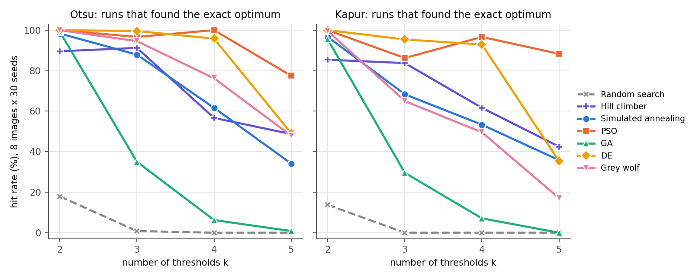
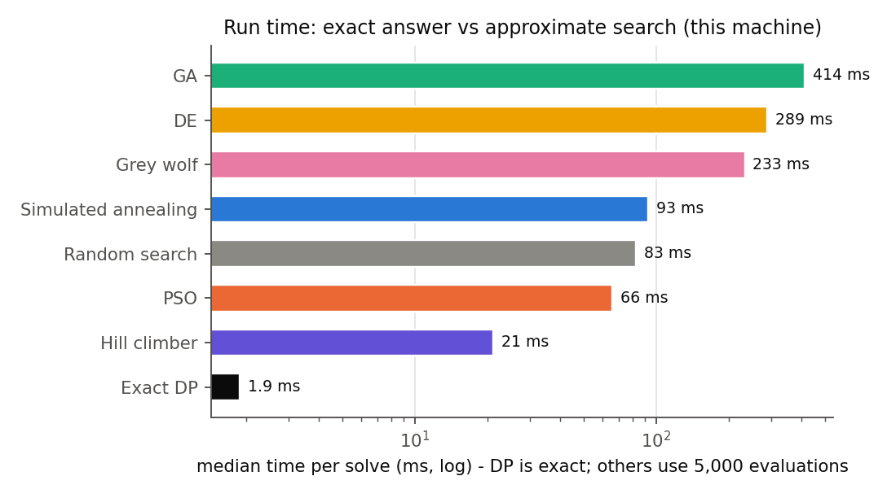
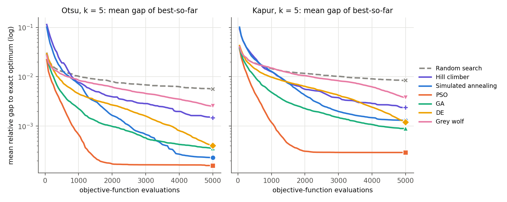
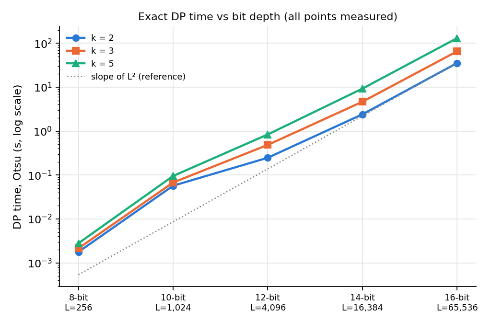

# Multilevel Thresholding: Exact DP vs Metaheuristics

**Is metaheuristic optimisation necessary for multilevel image thresholding?**
An exact-baseline evaluation with rigorous statistical comparison.

Course project for *Applied Statistics & Stochastic Processes* (DSU, CSE, 2026–27).



---

## The problem

Given a greyscale image with normalised histogram *p(i)*, *i* = 0…255, choose *k* thresholds
*t₁ < … < tₖ* in [1, 254] that maximise either:

- **Otsu**: the between-class variance, or
- **Kapur**: the summed entropy of the classes.

Many papers solve this with metaheuristics such as PSO, GA, DE or Grey Wolf.
Both objectives are **additively separable over classes**, though, so **exact dynamic
programming** finds the global optimum in O(k·L²).
The exact DP for Otsu is known from earlier work (Merzban & Elbayoumi, 2019) and is not
claimed as new here.
This project measures what the approximation actually costs.

## Research questions

| | Question | Answer from this repo |
|---|---|---|
| **Q1** | Is the exact optimum reachable? | Yes. For 8-bit images the DP takes about 2 ms for both criteria. |
| **Q2** | What does approximation cost? | No metaheuristic is reliably exact. The best, PSO, hits the optimum in 93.5% (Otsu) and 92.8% (Kapur) of runs, and each run is slower than the DP. |
| **Q3** | Where is approximation still needed? | At high bit depth (16-bit: 35 s to about 3 min per exact solve), and for criteria the DP can't handle (Tsallis, 2-D histograms, spatial terms). |

## Experiment

- **8 images:** camera, coins, moon, page, clock, astronaut, coffee, cell (from scikit-image)
- **2 objectives:** Otsu, Kapur
- **k ∈ {2, 3, 4, 5}**
- **7 optimisers**, all hand-written: random search, hill climber, simulated annealing, PSO, GA,
  DE (rand/1/bin) and Grey Wolf
- **30 seeds** per cell
- **5,000 objective evaluations per run** for every optimiser, enforced by a shared counter.
  Optimisers are compared on equal evaluations, never on iterations.

This gives 8 × 2 × 4 × 7 × 30 = **13,440 runs**.
Every run is scored against the DP's exact optimum. A run is a *hit* if its gap to the optimum
is at most 1e-9 × max(1, |optimum|).

**Statistics.** The unit of replication is the image, not the run, so results are first
aggregated over seeds. The analysis then runs:

- a Friedman test, followed by a Nemenyi post-hoc test with a critical-difference diagram;
- pairwise Wilcoxon signed-rank tests with Holm correction;
- an Aligned Rank Transform (ART) analysis.

Effect sizes (Kendall's W) are reported alongside the p-values.

## Results

Numbers below are copied from `results/stats_report.txt` and `results/timing_log.txt`,
which the scripts in this repo produced.

### Hit rate (share of runs that found the exact optimum)

| Algorithm | Otsu | Kapur | Median time / run (Otsu) |
|---|---:|---:|---:|
| Random search | 4.7% | 3.4% | 82 ms |
| Hill climber | 71.6% | 68.3% | 20 ms |
| Simulated annealing | 70.5% | 63.5% | 92 ms |
| **PSO** | **93.5%** | **92.8%** | 65 ms |
| Genetic algorithm | 35.3% | 33.0% | 415 ms |
| Differential evolution | 86.1% | 80.9% | 294 ms |
| Grey Wolf | 79.7% | 57.8% | 233 ms |
| **Exact DP** | **100%** | **100%** | **1.9 ms** (median over all cases) |

- Every method gets less reliable as *k* grows: compare *k* = 5 with *k* = 2 in the figure above.
- **Friedman** is significant in every (objective, *k*) condition.
- **Nemenyi** (CD = 3.18) ranks PSO best, but only separates it from GA and random search.
- **Wilcoxon + Holm** can't reach significance with 8 images, by construction.
  The smallest possible exact p is 0.0078, and Holm over 21 pairs raises it to 0.164.
  The report explains this.

<p float="left">
  
  
</p>

### Exact DP vs exhaustive search (camera, Otsu)

| k | Candidate threshold sets | Exhaustive search | Exact DP |
|---:|---:|---:|---:|
| 1 | 254 | 0.1 ms | 1.6 ms |
| 3 | 2,699,004 | 1.2 s | 1.7 ms |
| 5 | 8,468,125,050 | ≈ 63 min (extrapolated) | 2.1 ms |
| 10 | 2.6 × 10¹⁷ | ≈ 3,621 years (extrapolated) | 3.0 ms |

These timings were measured on a single-threaded cloud machine, not a laptop.
`measure_timing.py` prints the full environment.

### Bit-depth scaling (Q3)

The DP's cost grows roughly as L² (measured exponent 1.90–1.96). At 16-bit (L = 65,536) one
exact solve takes 35 s to 3 min, and that is where approximation becomes defensible.



## Interactive demo

A Streamlit app runs the exact DP and any of the seven optimisers live on a benchmark image, or
on your own upload. It shows:

- the results table (score, gap, hit, PSNR, SSIM, time);
- the histogram with every method's thresholds marked;
- convergence curves of the gap to the optimum;
- the resulting segmentations.

```bash
.venv\Scripts\streamlit run app.py
```

Every number on screen comes from the same functions used in the experiment.

## Getting started

Requires Python 3.9+.

```bash
git clone https://github.com/ArnavChoudhary-007/Multilevel-Image-Thresholding-via-Metaheuristics.git
cd Multilevel-Image-Thresholding-via-Metaheuristics
python -m venv .venv
.venv\Scripts\activate          # Windows  (source .venv/bin/activate on macOS/Linux)
pip install -r requirements.txt
```

### Reproducing everything

Run the scripts in this order with `python <script>`:

| Order | Script | What it does | Time |
|---|---|---|---|
| 1 | `verify_week1.py`, `verify_week2.py`, `test_optimisers.py` | Regression checks (56, 179 and 134 checks) | ~1–2 min each |
| 2 | `run_experiments.py --workers 4` | Full 13,440-run grid → `results/runs.csv` (resumable) | ~15–60 min |
| 3 | `analyse_stats.py` | Friedman, Nemenyi, Wilcoxon + Holm, ART | ~3 min |
| 4 | `make_figures.py`, `landscape_k2.py`, `sa_markov.py` | Figures, k = 2 landscape, SA as a Markov chain | ~1 min each |
| 5 | `measure_timing.py` | DP vs brute-force timing | ~1 min |
| 6 | `bitdepth_scaling.py` | DP at L = 256 … 65,536 | ~10 min |

`results/` and `figures/` are generated outputs and are not tracked by git.

## Repository layout

| File | Purpose |
|---|---|
| `thresholding.py` | **Core library**, the single source of truth. Otsu and Kapur scores, exact DP (`dp_multilevel`), brute force, segmentation, PSNR/SSIM. |
| `optimisers.py` | Seven hand-written optimisers behind one `optimise(...)` interface, with a hard evaluation-budget counter. |
| `run_experiments.py` | The 13,440-run experiment grid. |
| `analyse_stats.py` | Statistical analysis. |
| `sa_markov.py` | Simulated annealing analysed empirically as a time-inhomogeneous Markov chain. |
| `bitdepth_scaling.py` | DP run time as bit depth grows (Q3). |
| `landscape_k2.py` | Full objective landscape at k = 2. |
| `measure_timing.py` | Wall-clock timing of DP vs exhaustive search. |
| `make_figures.py` | Paper figures → `figures/`. |
| `app.py` | Streamlit demo. |
| `verify_week1.py`, `verify_week2.py`, `test_optimisers.py` | Test suites. |
| `day5_benchmark.py` | Defines the 8-image benchmark. |
| `ASSP_Final_Report.pdf` | The full report. |
| `day1_histogram.py`, `D2_otsu.py`, `D3_kapur_entropy.py`, `Multilevel.py` | Early week-1 scripts, kept for history. |

## Report

The full write-up, with methodology, tables, figures and references, is in
[`ASSP_Final_Report.pdf`](ASSP_Final_Report.pdf).

## Author

Arnav Choudhary ([@ArnavChoudhary-007](https://github.com/ArnavChoudhary-007))
